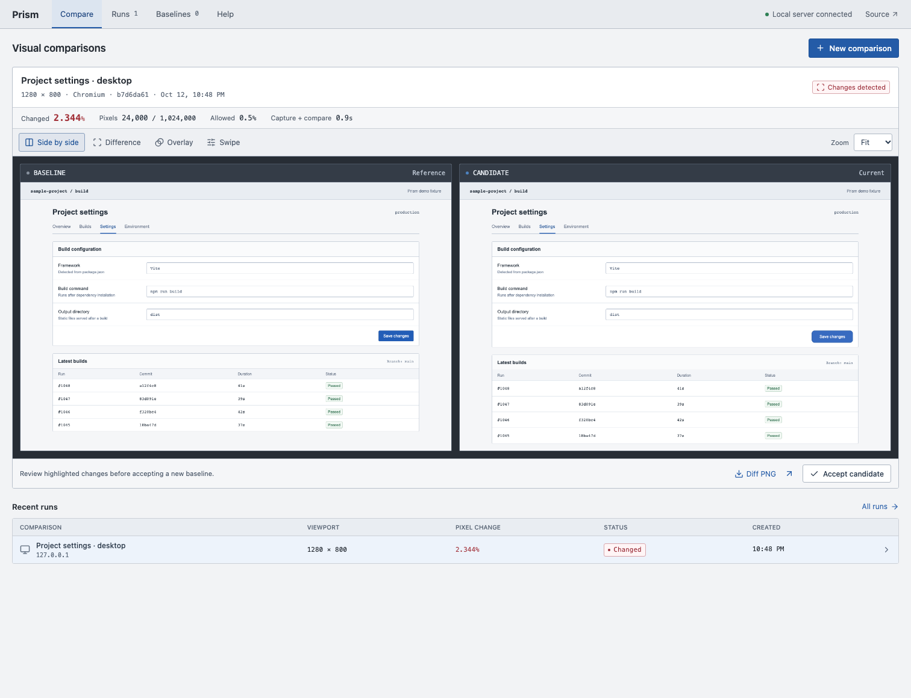
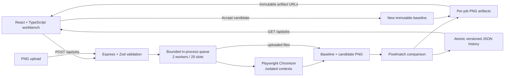

# Prism — Visual Regression Inspector

A local developer tool that turns two web pages into reviewable evidence of a visual regression. Prism captures real Chromium screenshots, compares pixels, and keeps the report and images together so a change can be inspected and accepted deliberately.



## Why I built it

A page can render successfully and still ship a broken layout. A settings form shifts, a button changes shape, or table rows move after a CSS update. Functional tests often pass while those changes go unnoticed.

Prism makes that problem easy to reproduce: point it at a baseline and candidate, capture them in the same environment, and inspect the measured difference. The included project-settings demo changes form alignment, button styling, and build-row spacing while keeping the data identical, so the complete workflow works without a separate application or external account.

## Run locally

Requires **Node.js 24+** and a Chromium browser installed through Playwright.

```bash
npm ci
npx playwright install chromium
npm run dev
```

Open **http://127.0.0.1:5174**. Click **Run comparison** to capture the bundled demo. The Node server runs at **http://127.0.0.1:4174**; Vite proxies `/api` and `/demo` to it.

For a production build served by one Node process:

```bash
npm run build
npm start
```

Open **http://127.0.0.1:4174**. This remains a local developer tool; a production bundle does not add public-hosting security or authentication.

On Linux, install browser system dependencies with `npx playwright install --with-deps chromium`.

## What works

- **Real URL capture:** HTTP(S) pages render in isolated Chromium contexts, at a chosen desktop, mobile, or custom viewport.
- **PNG comparison:** upload two equally sized PNGs instead of capturing URLs.
- **Measured reports:** changed pixel count, total pixels, changed percentage, allowed-change tolerance, and observed capture/comparison duration.
- **Four review views:** side by side, pixel difference, adjustable overlay opacity, and a swipe divider. Images can be viewed at their original size.
- **Persistent history:** completed, failed, queued, and running comparisons survive local server restarts in a versioned JSON store. Interrupted work becomes an actionable error.
- **Immutable baselines:** accepting a candidate saves a new reference image without rewriting the original report. Future URL captures automatically use its dimensions.
- **Bounded jobs:** two workers, a combined limit of 20 running/queued/admitted jobs, and a 45-second capture deadline. Concurrent acceptance requests resolve to one baseline.
- **Artifact export:** download the diff PNG or open the candidate screenshot.
- **Responsive UI:** keyboard-operable controls, labelled inputs, live progress and error states, and a reduced-motion mode.

## Architecture



The backend is ordinary Node ESM; the frontend is TypeScript. React handles the review experience, Vite builds the frontend, and Express serves both the API and built assets. Playwright and image comparison stay on the server. The workbench uses system fonts; capture rendering stays within Chromium.

`server/capture.mjs` controls the browser environment. `server/compare.mjs` decodes and compares PNGs. `server/store.mjs` serializes state writes through a temporary file and atomic rename. `server/index.mjs` owns admission, workers, artifact routes, and baseline acceptance. UI components live in `src/`.

## How a result is calculated

Pixelmatch uses a fixed **0.1 perceptual color sensitivity** and ignores detected antialiasing edges. This sensitivity is different from the user’s **allowed-change percentage**:

```text
changed percentage = changed pixels / total pixels × 100
pass = changed percentage <= allowed-change percentage
```

The decision uses the unrounded percentage. The UI displays three decimal places. Pink identifies changed pixels in the diff image; yellow identifies ignored antialiasing edges. Viewport captures use device scale 1, so the denominator equals viewport width × height.

For repeatability, Prism fixes locale (`en-US`), time zone (`UTC`), light color scheme, device scale, and reduced-motion preference. It waits for page DOM readiness, fonts, and images, disables CSS animations/transitions, hides the text caret, and waits an additional 500 ms before capture. It captures the viewport, not the full document.

## Verify it

```bash
npm run test
npm run build
npm run test:browser
# or all three:
npm run check
```

The tests use actual Chromium; they do not mock a screenshot result.

| Check | Evidence |
| --- | --- |
| PNG comparison | Zero changes, known full-image change, tolerance boundaries, dimension mismatch, and invalid PNG/size limits |
| API integration | Real baseline/candidate capture, downloadable diff, zero-diff rerun against an accepted snapshot, persisted history after restart |
| Concurrency | 30 simultaneous submissions produce exactly 20 admissions and 10 queue-limit responses; 8 simultaneous acceptance calls create one baseline |
| Recovery and validation | Interrupted jobs become errors; a real transient rename failure rejects its caller and later queued writes recover in order; invalid protocols, credentials, PNGs, and cross-site writes are rejected |
| Browser story | Run demo, inspect all four views, accept baseline, rerun to zero changes, upload matching PNGs, browse history, and check a 390 px viewport without horizontal overflow or page errors |

The included 1280 × 800 demo measured **24,000 changed pixels out of 1,024,000 (2.344%)** in the local browser walkthrough. Comparing its candidate to the accepted snapshot measured **0 changed pixels**. These are fixture results, not a throughput benchmark or a promise of identical percentages across operating systems. `docs/` contains the actual captured baseline, candidate, difference, desktop workspace, and mobile workspace PNGs.

CI repeats tests, build, and the browser story on Node 24 / Ubuntu, then uploads the PNG evidence.

## Decisions and tradeoffs

**Local first.** No account, cloud storage, or service credentials are needed. URLs may reach your own development servers, which is useful for comparing branches and preview builds.

**Atomic files over a database.** This keeps setup simple and makes history inspectable. Writes are serialized within one process. Run only one Prism server per data directory; multi-process concurrency and large histories need a database and a shared queue.

**Snapshots over recapturing a reference.** Two URLs can both drift. Accepting a candidate freezes the image so future checks measure against an explicit reference. Old reports remain intact.

**A bounded queue over unbounded browser processes.** Admission is reserved before asynchronous persistence, preventing bursts from exceeding the cap. Each capture job opens a browser and closes it when finished or timed out; uploaded PNGs use the same queue without a browser.

**Pixels over semantic assertions.** Pixel diffs can find unexpected visual changes, but they cannot determine whether a change is correct. Human review remains part of acceptance.

## Boundaries and limitations

Prism binds to `127.0.0.1` and accepts only local hostnames. Writes require JSON and block non-local browser origins. It is intended for trusted URLs on your own workstation. Browser contexts are isolated from each other, but they are **not a security boundary for untrusted web pages**. A screenshot target can issue network requests from the browser and can reach local/private services. HTTP(S) validation intentionally permits localhost for development.

Do not expose this server directly to the internet. A hosted version needs authentication, authorization, destination restrictions and DNS/redirect checks, network isolation, per-user quotas, and private artifact storage. There is no credential/session injection, login workflow, CI gating integration, selector masking, full-page capture, multi-browser comparison, or shared-user tenancy.

Dynamic timestamps, randomness, slow widgets, operating-system fonts, and third-party content can produce differences. Prism’s readiness waits are bounded and do not guarantee that every application has finished loading. Use deterministic fixtures and the same capture environment. Authenticated applications require an accessible test route or separately generated PNGs.

URL viewports are limited to 320–1920 px wide and 240–1200 px high. PNG uploads are limited to 5 MB each and 3 million decoded pixels; both images must have identical dimensions. A saved PNG baseline can be used for URL capture only when its dimensions fit the URL viewport limits. Requests are limited to 14 MB. Data is retained until you remove it; no automatic retention or disk quota is implemented.

History and screenshots live in `.prism/` and are excluded from Git. Stop the server before backing up or deleting this directory. Set `PRISM_DATA_DIR` to choose another directory, or `PORT` to change the backend port when serving the built app. The development frontend proxy uses port 4174.

## References

The implementation follows the primary documentation for [Playwright screenshots](https://playwright.dev/docs/screenshots), [Pixelmatch](https://github.com/mapbox/pixelmatch), [React](https://react.dev/), and [Vite](https://vite.dev/guide/).

MIT licensed. Built by Mert Kanıbir.
